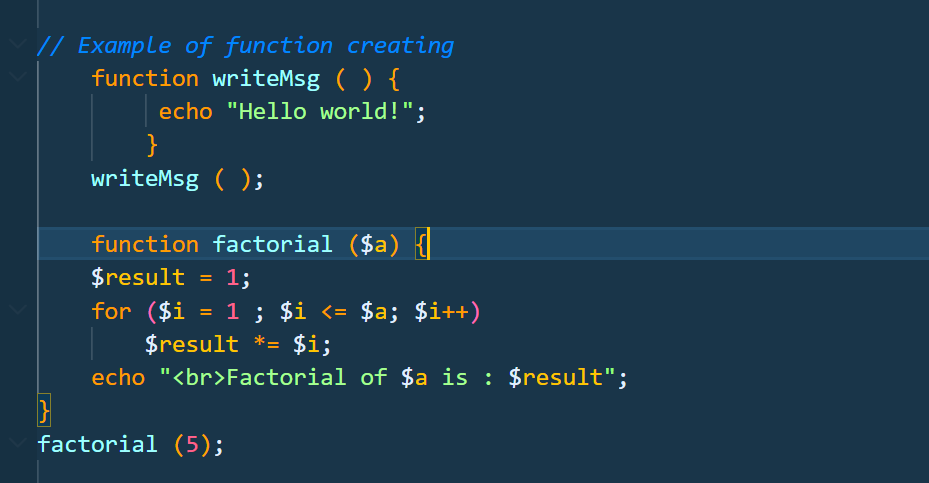
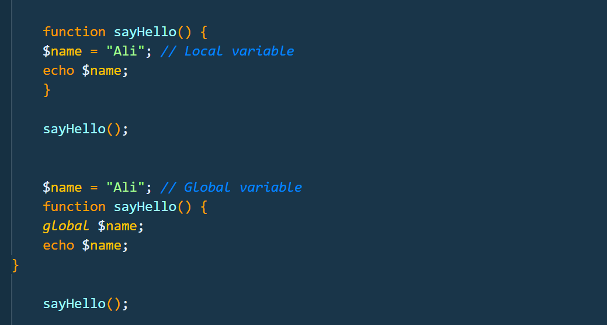
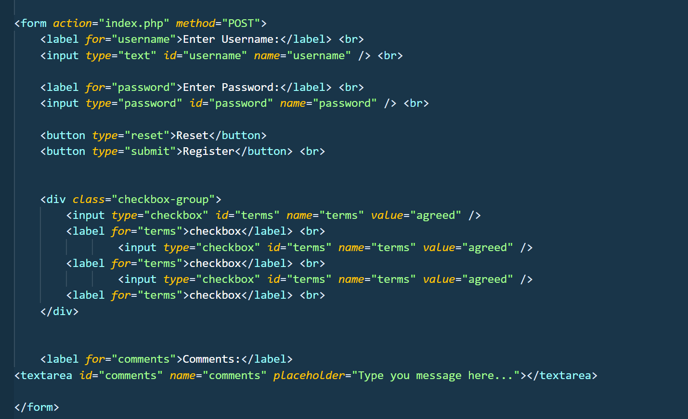

## Screenshot Name
`functions.png`

## Description
These examples demonstrate how to create and call functions in PHP. The first function displays a greeting message, while the second function accepts a number as a parameter and calculates its factorial.
- Key Points
- function → Used to create a function.
- writeMsg() → Displays the message "Hello world!".
- factorial($a) → Accepts a number as a parameter.
- for loop → Repeats multiplication from 1 to the given number.
- $result *= $i → Multiplies the result by the current number.
- factorial(5) → Calls the function with the value 5.
- echo → Displays the output.

  ## Screenshot

## Screenshot Name
`local-global-variable.png`

## Description

These examples demonstrate the difference between local and global variables in PHP. A local variable is created inside a function and can be used within that function, while a global variable is created outside a function and can be accessed inside the function using the global keyword.
- Key Points
- Local variable → Declared inside a function and used within that function.
- Global variable → Declared outside a function.
- global keyword → Allows a function to access a global variable.
- sayHello() → Calls the function and displays the variable value.
- Both examples display Ali.

  ## Screenshot

## Screenshot Name
`forms.png`

## Description

This code demonstrates how to create an HTML form that allows users to enter a username and password, select checkboxes, write comments, and submit or reset the form. The form uses the POST method to send the entered data to index.php.
- Key Points
- <form> → Creates a form for collecting user information.
- action="index.php" → Specifies where the form data is sent.
- method="POST" → Sends form data in the request body.
- <label> → Provides a description for each input field.
- <input type="text"> → Allows users to enter a username.
- <input type="password"> → Hides the password characters while typing.
- <input type="checkbox"> → Allows users to select options.
- <button type="reset"> → Resets the form fields.
- <button type="submit"> → Submits the form.
- <textarea> → Allows users to enter longer comments.
- 
 → Groups the checkbox elements together.

  ## Screenshot

