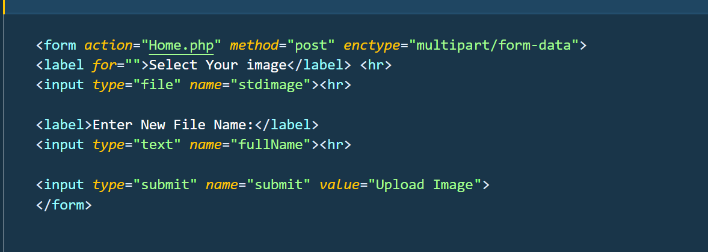
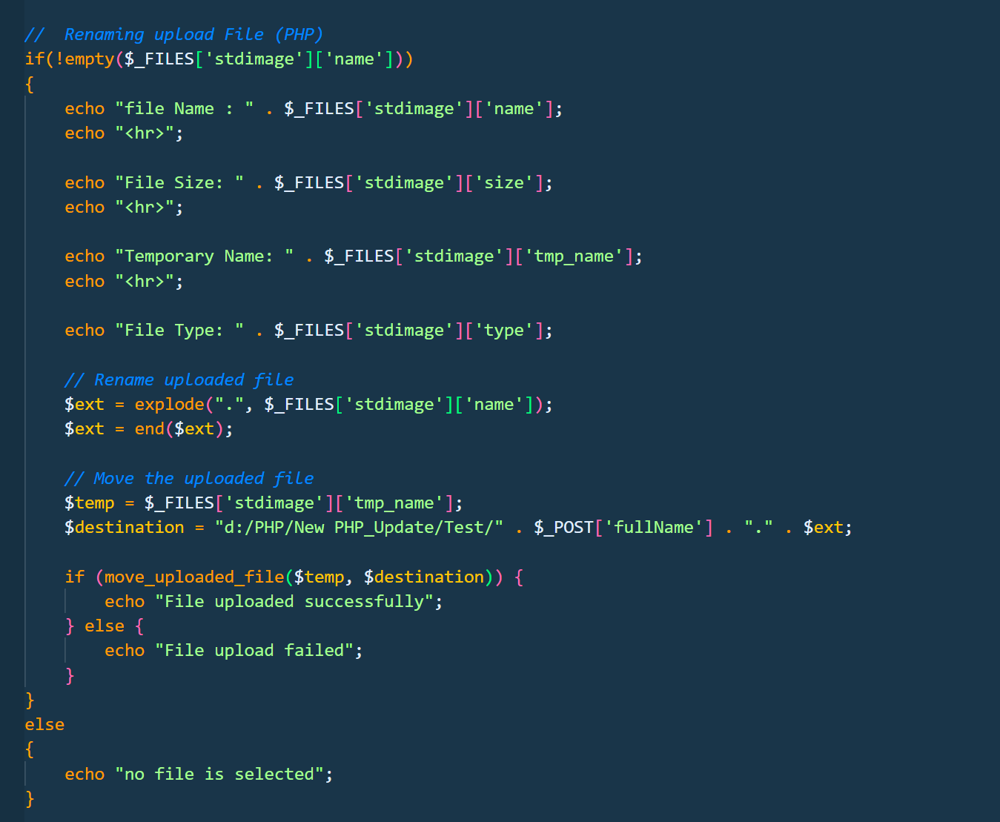
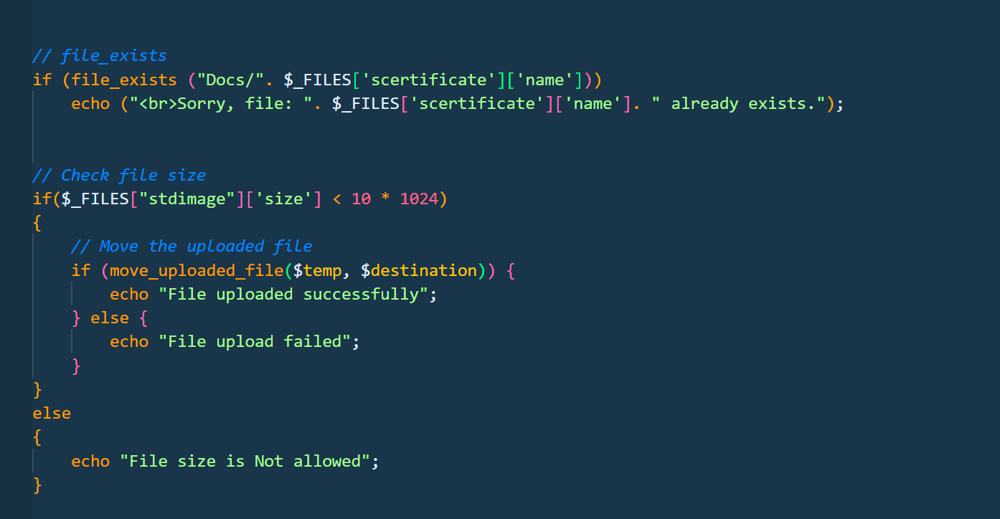

## Screenshot Name
`Form`
## Description

This code demonstrates how to create an HTML file upload form that allows users to select an image from their computer, enter a new file name, and upload the image to Home.php. It uses multipart/form-data to support file uploads.
Key Points
- <form> → Creates a form for uploading an image.
- action="Home.php" → Specifies the PHP file that receives the submitted data.
- method="post" → Sends form data using the POST method.
- enctype="multipart/form-data" → Allows the form to upload files.
- <input type="file"> → Allows users to select an image from their computer.
- name="stdimage" → Identifies the uploaded image in PHP.
- <input type="text"> → Allows users to enter a new file name.
- name="fullName" → Identifies the new file name in PHP.
- <input type="submit"> → Creates a button to submit the form.
- 
 → Adds horizontal lines to separate form elements.

  ## Screenshot

## Screenshot Name
`renaming-Move-uploaded-file`
## Description

This code demonstrates how to upload and rename a file using PHP. It checks whether the user has selected a file, retrieves information about the uploaded file, extracts its extension, and moves it to a specified folder using the new file name entered in the HTML form.
Key Points
- $_FILES → Accesses information about uploaded files.
- !empty() → Checks whether a file has been selected.
- $_FILES['stdimage']['name'] → Gets the original file name.
- $_FILES['stdimage']['size'] → Gets the file size.
- $_FILES['stdimage']['tmp_name'] → Gets the temporary location of the uploaded file.
- $_FILES['stdimage']['type'] → Gets the file's reported MIME type.
- explode() → Splits the original file name using the dot (.) separator.
- end() → Gets the last element, which contains the file extension.
- $_POST['fullName'] → Gets the new file name entered by the user.
- move_uploaded_file() → Moves the uploaded file from its temporary location to the destination folder.
- if...else → Checks whether the file upload was successful.
- else → Displays a message if no file is selected.

  ## Screenshot

## Screenshot Name
`file_exists_file_size`
## Description

This code demonstrates how to validate uploaded files before saving them. It checks whether a file with the same name already exists in the destination folder and whether the uploaded file size is less than 10 KB. If the file meets the size condition, PHP attempts to move it to the destination folder.
Key Points
- file_exists() → Checks whether a file already exists in a specified location.
- $_FILES['scertificate']['name'] → Gets the original uploaded file name.
- $_FILES['stdimage']['size'] → Gets the uploaded file size in bytes.
- 10 * 1024 → Represents 10 KB in bytes.
- < → Checks whether the file size is less than 10 KB.
- move_uploaded_file() → Moves the uploaded file to the destination folder.
- if...else → Checks whether the upload is successful or the file size is not allowed.
- Displays an error message if the file already exists or exceeds the allowed size.

  ## Screenshot

## Screenshot Name
`Uploading-multiple-files`
## Description

This code demonstrates how to upload multiple files at the same time using PHP. It uses a for loop to process each selected file individually. It also checks whether a file already exists, validates its size and extension, and moves valid files to the destination folder.
Key Points
- $_FILES → Accesses information about uploaded files.
- !empty() → Checks whether at least one file has been selected.
- count() → Counts the total number of selected files.
- for loop → Processes multiple files one by one.
- [$i] → Accesses information about the current file.
- file_exists() → Checks whether the file already exists in the destination folder.
- size → Checks the uploaded file size.
- explode() → Splits the file name to extract its extension.
- end() → Gets the file extension.
- strtolower() → Converts the extension to lowercase.
- in_array() → Checks whether the extension is in the allowed extensions array.
- move_uploaded_file() → Moves the uploaded file to the destination folder.
- if...else → Handles successful uploads and validation errors.

  ## Screenshot

